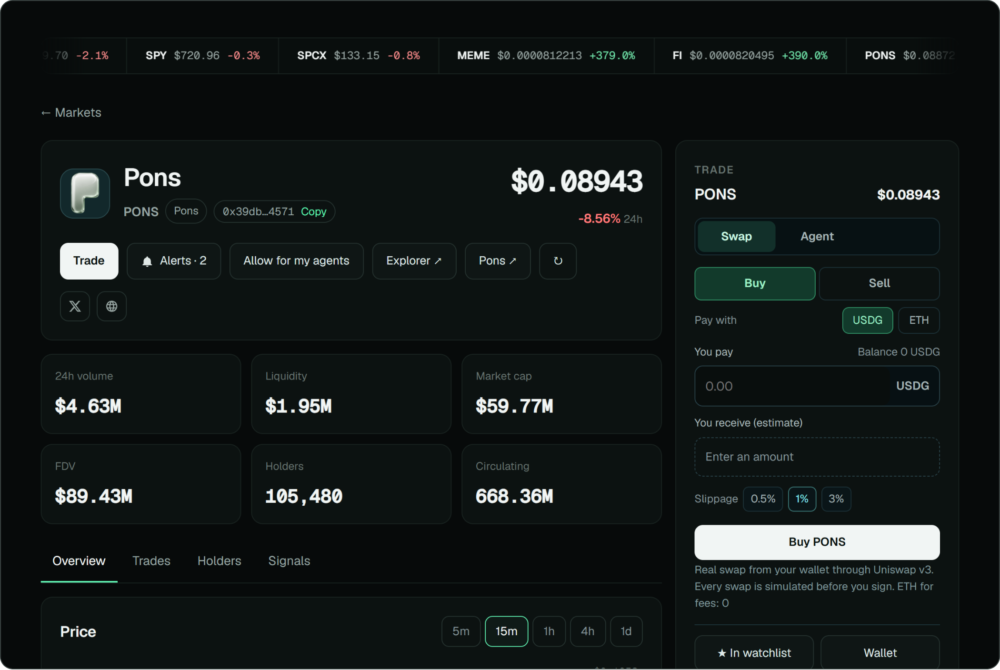
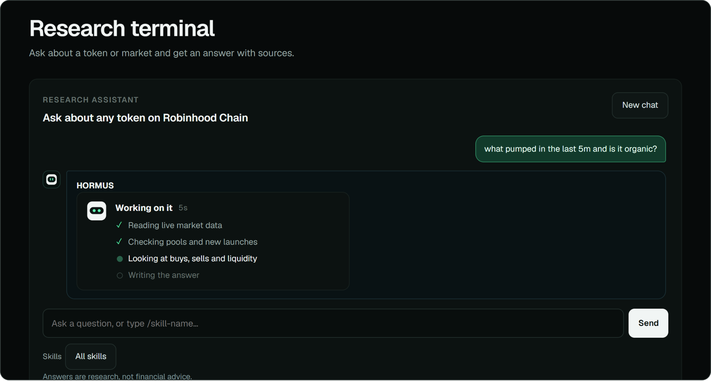
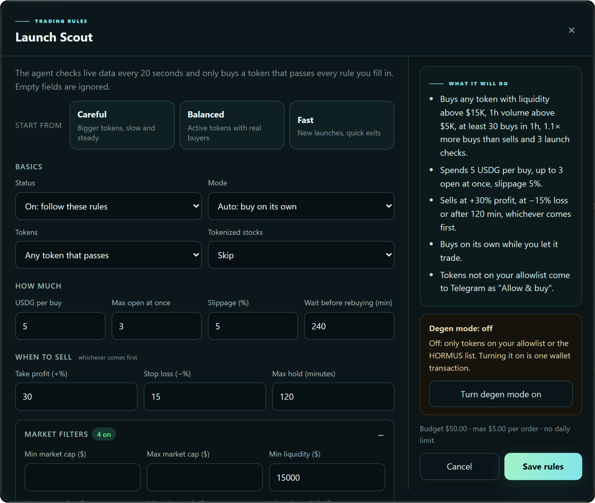
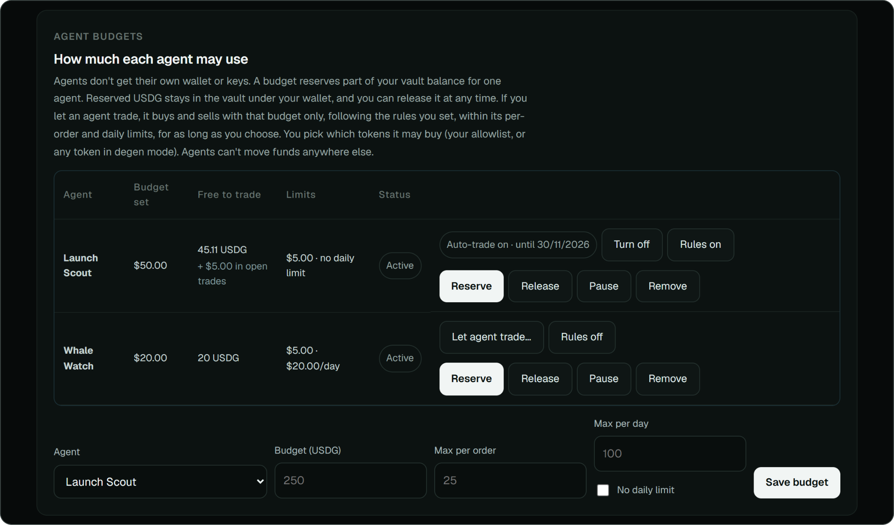
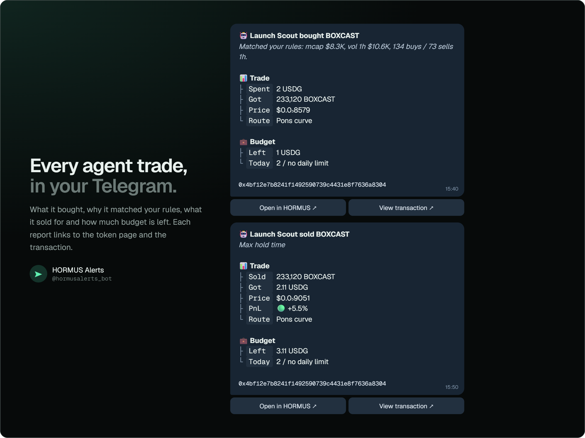
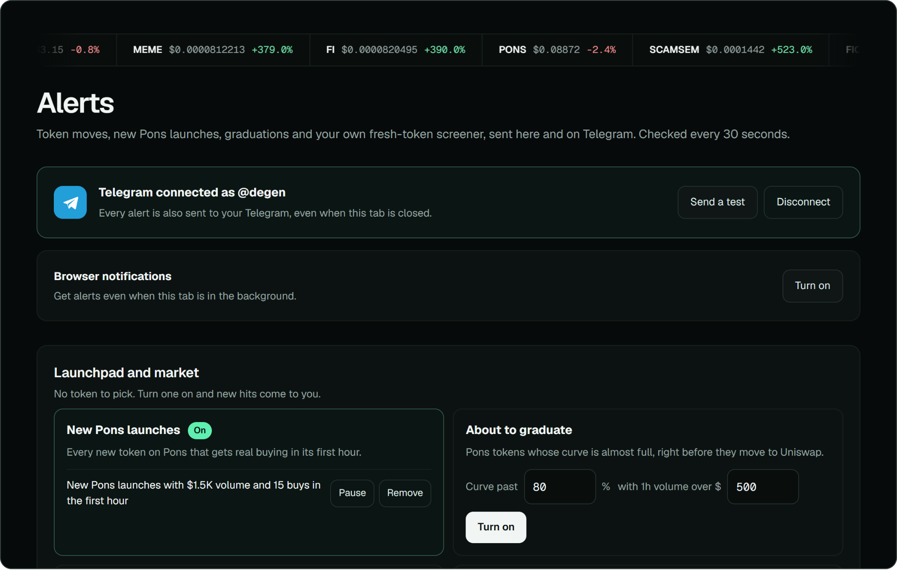
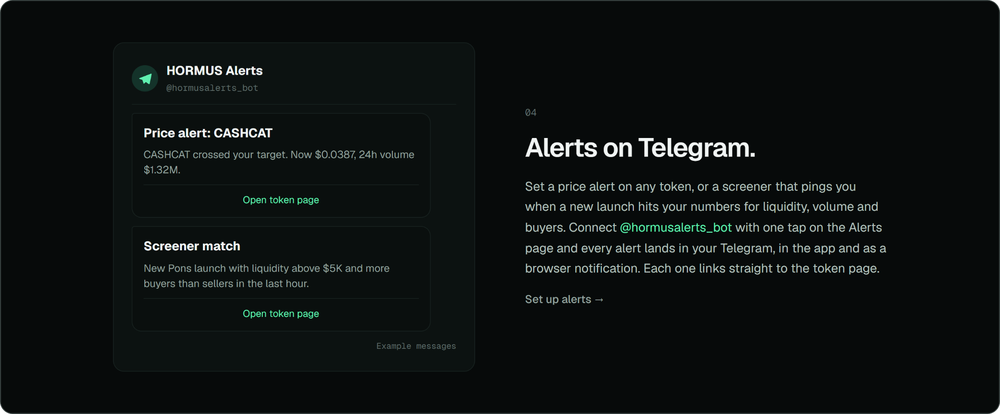
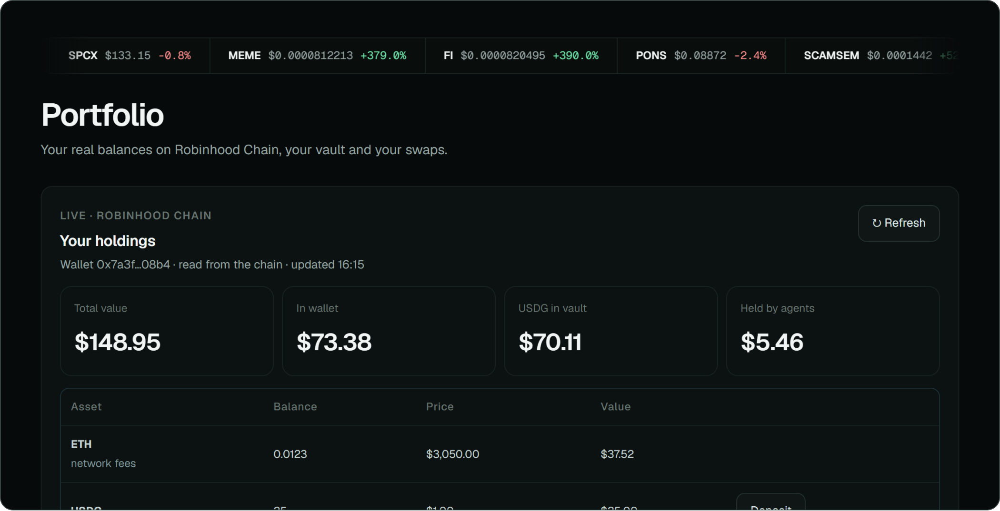
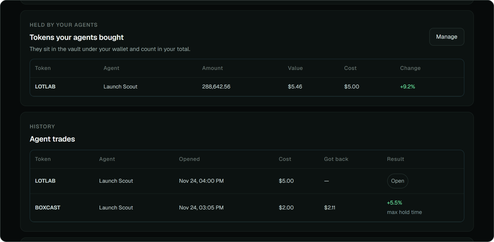

<a href="https://hormus.io"></a>

<p align="center">
  <a href="https://hormus.io"><b>Website</b></a> &nbsp;·&nbsp;
  <a href="https://app.hormus.io"><b>Open the app</b></a> &nbsp;·&nbsp;
  <a href="https://docs.hormus.io"><b>Docs</b></a> &nbsp;·&nbsp;
  <a href="https://x.com/hormusapp"><b>X</b></a> &nbsp;·&nbsp;
  <a href="https://t.me/hormusalerts_bot"><b>Telegram alerts</b></a>
</p>

<br>

HORMUS is a research and trading app for Robinhood Chain. It shows what is moving right now, what just launched on Pons, who is buying and who is selling, and how deep the liquidity is. You can ask the research terminal a question in plain words, get alerts on Telegram, swap from your own wallet, and let an agent trade a budget you set, following rules you write.

This repo holds everything that runs in your browser plus the vault contracts, so anyone can check what the app does with their wallet.

| | |
|---|---|
| **Live Pulse** | Every token on the chain ranked by the last 5m, 1h, 6h or 24h, with fresh Pons launches |
| **Token pages** | Chart, liquidity, holders, live trades, launch checks and a swap panel on one page |
| **Research terminal** | Ask in plain words, get numbers back with their sources |
| **Agent trading** | Agents buy and sell inside the vault, only with the budget and rules you set |
| **Telegram alerts** | Price moves, new launches, your own screener and every agent trade, sent to `@hormusalerts_bot` |
| **Portfolio** | Wallet, vault and agent positions read from the chain, in one total |

<br>

## Live Pulse

Every token on the chain ranked by what it did in the last 5 minutes, hour, 6 hours or day. Fresh launches show up within minutes, with buys against sells, liquidity and how far along their Pons curve they are.

<a href="https://app.hormus.io/markets"></a>

<br>

## Token pages

One page per token: price, chart, volume, holders and live trades, plus a swap panel on the side. Pay with USDG or ETH and HORMUS finds the route through Uniswap v3, Uniswap v4 or the Pons curve, then simulates the swap before you sign it. Links to the explorer, the Pons launch page and GeckoTerminal sit right there, so you can check everything yourself.

<a href="https://app.hormus.io/markets"></a>

<br>

## Research terminal

Ask what pumped in the last five minutes, whether a launch looks organic, or who is buying and selling a token. The agent reads live chain data, shows each step while it works and lists its sources under the answer.

<a href="https://app.hormus.io/terminal"></a>

<br>

## Agent trading

Give an agent a budget from your vault, write its rules, and let it trade for as long as you choose. It checks live data every 20 seconds and only buys a token that passes every rule you fill in.

**Rules.** Start from a preset (Careful, Balanced or Fast) or write your own: market cap, liquidity, volume, buys against sells, age, Pons curve, and launch checks like top 10 holders, snipers, bundles and dev holdings. Then when to sell: take profit, stop loss or a max hold time, whichever comes first. The window spells out in plain words what the agent will do before you save.

<a href="https://app.hormus.io/funding"></a>

**Budgets and limits.** Each agent gets its own budget, a max per order and an optional daily limit. You decide which tokens it may buy: only your allowlist (signed once, no gas), any token that passes your rules in degen mode, or ask first on Telegram with Buy and Skip buttons.

<a href="https://app.hormus.io/funding"></a>

**Reports.** Every buy and sell lands in Telegram: what it bought, why it matched your rules, the route, the result and how much budget is left.



The first agent trade on mainnet: a Launch Scout style agent bought BOXCAST through the Pons curve about 25 seconds after it was switched on, and sold it 10 minutes later on its max hold rule for +5.5%.

<br>

## Telegram alerts

Set a price alert on any token, or a screener that pings you when a new launch hits your numbers. Connect `@hormusalerts_bot` with one tap and every alert lands in Telegram, in the app and as a browser notification, each with a link straight to the token page.

<a href="https://app.hormus.io/alerts"></a>

<a href="https://hormus.io/#alerts"></a>

<br>

## Portfolio

Your wallet, your USDG in the vault and the tokens your agents hold, all read from the chain and added into one total. Agent trades have their own history with cost, what came back and why each position closed. Move any agent position to your wallet and it shows up here, ready to sell by hand.

<a href="https://app.hormus.io/portfolio"></a>

<a href="https://app.hormus.io/portfolio"></a>

<br>

## Research agents and skills

Agents can also just watch. Create one, give it skills like rug check or whale tracker, and let it run research on a schedule. Every report lands in your Activity with its sources.

<a href="https://app.hormus.io/agents"></a>

<br>

## What is in this repo

```
app/         the website and app (hormus.io and app.hormus.io)
docs/        the docs site (docs.hormus.io)
contracts/   HORMUS USDG vault contracts and their tests
```

The app is a single `index.html` with no build step. Sign-in and the embedded wallet come from Privy (`privy-auth.js`). Market data, alerts and the agent executor run on the HORMUS API, which is not part of this repo.

## Contracts

All on Robinhood Chain (chain id 4663).

| Contract | Address | Status |
|---|---|---|
| HormusAgentVaultV2 | [`0x5156281349c6EF0F992F2D20B33376585257F3d9`](https://robinhoodchain.blockscout.com/address/0x5156281349c6EF0F992F2D20B33376585257F3d9?tab=contract) | Live, source verified on Blockscout |
| HormusAgentVault (v1) | [`0xC1a68e303354537A29F34aA178821F799a91D32e`](https://robinhoodchain.blockscout.com/address/0xC1a68e303354537A29F34aA178821F799a91D32e) | Previous vault, withdrawals only |
| USDG | [`0x5fc5360D0400a0Fd4f2af552ADD042D716F1d168`](https://robinhoodchain.blockscout.com/address/0x5fc5360D0400a0Fd4f2af552ADD042D716F1d168) | Token used by the vault |

### How the vault keeps agent trading in bounds

- Your USDG stays in the vault under your address. Only you can deposit, release a budget or withdraw.
- An agent can only trade after you switch it on for that agent, and only until the time you picked. You can switch it off at any moment.
- Every buy is checked on chain against the agent's budget, max per order and daily limit, and against your token choice (your allowlist, the owner list, or degen mode if you turned it on).
- Trades go through Uniswap v3, Uniswap v4 or the token's Pons curve, and always start and end inside the vault. The executor key can call buy and sell, nothing else: it cannot withdraw or send funds to any address.
- Tokens an agent bought are recorded under your address and agent. You can move them to your own wallet at any time with `withdrawPosition`.
- The owner can pause new deposits, new budgets and all agent trades in one call. Releasing budgets, withdrawing and moving positions out always stay open, paused or not.

The vault has its own test suite (`contracts/test`). It has not had an external audit yet, so start with amounts you are fine losing.

## Run it locally

The app and docs are static files, so any static server works:

```bash
npx serve app
npx serve docs
```

You can browse the site locally, but sign-in may not work there: Privy only accepts sign-ins from the domains allowed in its dashboard.

To compile the contracts and run the vault tests:

```bash
cd contracts
npm install
npm test
```

## Safety

- HORMUS never asks for your seed phrase or private key.
- Every manual swap is simulated before you sign it, and you sign it in your own wallet.
- Agents only trade the budget you reserved, inside the limits you set, and you can stop them at any time.
- Always check the contract address of a token. Names and tickers can be copied.
- Nothing here is financial advice.

Found a problem? Open an issue. For anything security related, send a DM to [@hormusapp](https://x.com/hormusapp) instead of posting it publicly.

## License

MIT

<br>

---

<p align="center">
  <a href="https://hormus.io"></a>
</p>

<p align="center">
  <a href="https://hormus.io">hormus.io</a> &nbsp;·&nbsp;
  <a href="https://app.hormus.io">app.hormus.io</a> &nbsp;·&nbsp;
  <a href="https://docs.hormus.io">docs.hormus.io</a> &nbsp;·&nbsp;
  <a href="https://x.com/hormusapp">x.com/hormusapp</a> &nbsp;·&nbsp;
  <a href="https://t.me/hormusalerts_bot">t.me/hormusalerts_bot</a>
</p>

<p align="center"><sub>Built on Robinhood Chain · 4663</sub></p>
