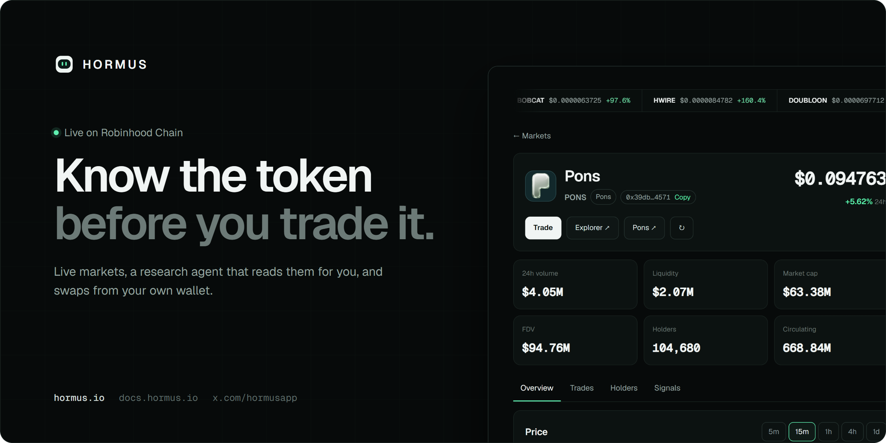
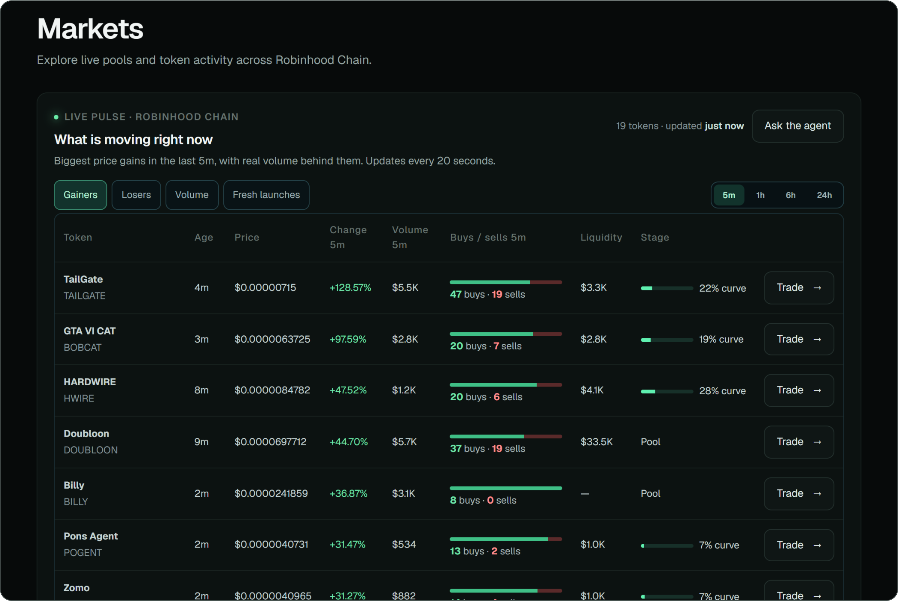
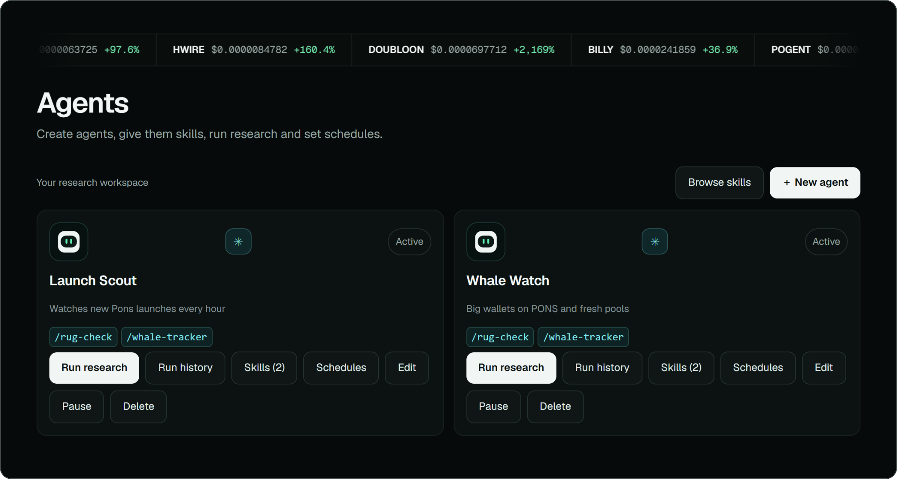
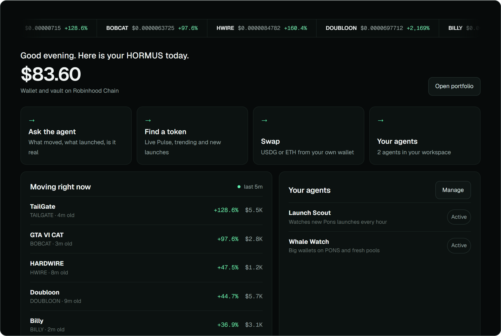

<a href="https://hormus.io"></a>

<p align="center">
  <a href="https://hormus.io"><b>Website</b></a> &nbsp;·&nbsp;
  <a href="https://app.hormus.io"><b>Open the app</b></a> &nbsp;·&nbsp;
  <a href="https://docs.hormus.io"><b>Docs</b></a> &nbsp;·&nbsp;
  <a href="https://x.com/hormusapp"><b>X</b></a>
</p>

<br>

HORMUS is a research and trading app for Robinhood Chain. It shows what is moving right now, what just launched on Pons, who is buying and who is selling, and how deep the liquidity is. You can ask the research terminal a question in plain words, let agents watch the market on a schedule, and swap straight from your own wallet.

This repo holds everything that runs in your browser plus the vault contracts, so anyone can check what the app does with their wallet.

<br>

## Live Pulse

Every token on the chain ranked by what it did in the last 5 minutes, hour, 6 hours or day. Fresh launches show up within minutes, with buys against sells, liquidity and how far along their Pons curve they are.

<a href="https://app.hormus.io/markets"></a>

<br>

## Token pages

One page per token: price, chart, volume, holders and live trades, plus a swap panel on the side. Links to the Robinhood Chain explorer, the Pons launch page and GeckoTerminal sit right there, so you can check it yourself.

<a href="https://app.hormus.io/markets"></a>

<br>

## Research terminal

Ask what pumped in the last five minutes, whether a launch looks organic, or who is buying and selling a token. The agent reads live chain data, shows each step while it works and lists its sources under the answer.

<a href="https://app.hormus.io/terminal"></a>

<br>

## Agents and skills

Create agents that run research on a schedule and write short reports. Give them skills like rug check or whale tracker. When an agent spots a trade idea it waits for your approval, nothing moves without your signature.

<a href="https://app.hormus.io/agents"></a>

<br>

## Your day at a glance

The overview puts your wallet and vault balance, what is moving right now and what your agents are up to on one screen.

<a href="https://app.hormus.io/overview"></a>

<br>

## What is in this repo

```
app/         the website and app (hormus.io and app.hormus.io)
docs/        the docs site (docs.hormus.io)
contracts/   HORMUS USDG vault contracts and their tests
```

The app is a single `index.html` with no build step. Sign-in and the embedded wallet come from Privy (`privy-auth.js`). Market data is served by the HORMUS API, which is not part of this repo.

## Contracts

All on Robinhood Chain (chain id 4663).

| Contract | Address | Status |
|---|---|---|
| HormusAgentVault (v1) | [`0xC1a68e303354537A29F34aA178821F799a91D32e`](https://robinhoodchain.blockscout.com/address/0xC1a68e303354537A29F34aA178821F799a91D32e) | Live, source verified on Blockscout |
| HormusAgentVaultV2 | not deployed | Work in progress |
| USDG | [`0x5fc5360D0400a0Fd4f2af552ADD042D716F1d168`](https://robinhoodchain.blockscout.com/address/0x5fc5360D0400a0Fd4f2af552ADD042D716F1d168) | Token used by the vault |

The v1 vault keeps your USDG under your address. You deposit, set a budget for each agent and withdraw with your own signature. Budgets are bookkeeping only: v1 has no function that lets an agent or the HORMUS backend move your funds. The owner key can only pause new deposits and new budgets; releasing a budget and withdrawing always stay open.

v2 adds optional agent trading inside the limits you set. It is not deployed and nothing in the app uses it yet.

## Run it locally

The app and docs are static files, so any static server works:

```bash
npx serve app
npx serve docs
```

You can browse the site locally, but sign-in may not work there: Privy only accepts sign-ins from the domains allowed in its dashboard.

To compile the contracts and run the vault tests:

```bash
cd contracts
npm install
npm test
```

## Safety

- HORMUS never asks for your seed phrase or private key.
- Every swap is simulated before you sign it, and you sign it in your own wallet.
- Always check the contract address of a token. Names and tickers can be copied.
- Nothing here is financial advice.

Found a problem? Open an issue. For anything security related, send a DM to [@hormusapp](https://x.com/hormusapp) instead of posting it publicly.

## License

MIT

<br>

---

<p align="center">
  <a href="https://hormus.io"></a>
</p>

<p align="center">
  <a href="https://hormus.io">hormus.io</a> &nbsp;·&nbsp;
  <a href="https://app.hormus.io">app.hormus.io</a> &nbsp;·&nbsp;
  <a href="https://docs.hormus.io">docs.hormus.io</a> &nbsp;·&nbsp;
  <a href="https://x.com/hormusapp">x.com/hormusapp</a>
</p>

<p align="center"><sub>Built on Robinhood Chain · 4663</sub></p>
